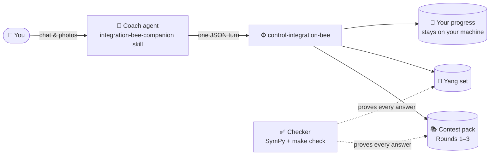

# 🐝 Integration Bee

[](https://github.com/jerome-queck/integration-bee/actions/workflows/check.yml)


A free practice and coaching pack for the UK University Integration Bee. ∫

You chat with an AI coach. It finds what you already know, teaches what you don't, gives you real contest integrals, and marks your working (even a photo of it). Every answer in the pack has been checked by a computer. You never need to run a command yourself.

## ✨ What's inside

- 📚 **The pack**: past contest problems from Rounds 1–3, each with a checked answer and a solution note.
- 📖 **The Yang set**: every problem from the Yang Topics Guide (2nd edition), with worked solutions.
- ✅ **The checker**: SymPy proves every stored answer, and `make check` runs on every change.
- 🤖 **The coach**: an agent skill that teaches, drills, and marks, and remembers your progress.

## 🗺️ How it fits together



More detail: [docs/architecture.md](docs/architecture.md).

## 🚀 Get started

1. Clone the repo:

   ```bash
   git clone https://github.com/jerome-queck/integration-bee.git
   cd integration-bee
   ```

2. Open it in your AI agent (Codex, Claude Code, or Cursor) and paste this:

   > Set up this repo using the setup-integration-bee skill: run `scripts/setup.py`, confirm it prints SETUP OK and READY integration-bee, then start the integration-bee-companion so I can study.

That's it. 🎉 Setup is one script, `scripts/setup.py`, that works the same on macOS, Linux, and Windows and is safe to run again. Your agent follows the [setup skill](.agents/skills/setup-integration-bee/SKILL.md).

Prefer doing it by hand, or maintaining the pack? See [docs/setup-manual.md](docs/setup-manual.md).

## 🧩 Agent skills

Skills live in `.agents/skills/`; `.cursor/skills/` and `.claude/skills/` link to them.

- `.agents/skills/setup-integration-bee/SKILL.md`: set up a fresh clone
- `.agents/skills/integration-bee-companion/SKILL.md`: the coach
- `.agents/skills/verify-integration-bee/SKILL.md`: drive and check the CLI
- `.agents/skills/formal-verify-integration-bee/SKILL.md`: formal checks

Contributing agents start with [AGENTS.md](AGENTS.md).
