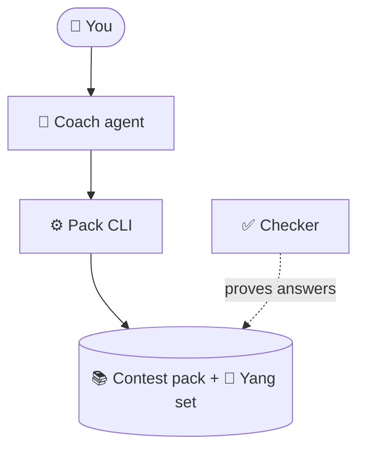

# Architecture

How the pack, the Yang set, the checker, and the companion fit together. The short picture is the diagram in the [README](../README.md); setup lives in [setup-manual.md](setup-manual.md).

## Diagram detail

The README shows the learner journey as a statechart ([journey.mmd](images/journey/journey.mmd), model and render steps in [images/journey/README.md](images/journey/README.md)). It has 10 states in five phases (get set up, find your level, practise, learn, prove it) and 14 arrows, so it fits GitHub's default view. It leaves out the parts below.

How the pieces fit together:



- You chat with the coach and can send photos of handwritten working.
- The coach is the `integration-bee-companion` skill. It sends one JSON turn to `scripts/control-integration-bee`.
- The CLI reads the contest pack (Rounds 1–3) and the Yang set from `problems/records.jsonl`, and writes your progress to the data directory (`trackers/live` by default). Progress stays on your machine.
- The checker (SymPy plus `make check`) proves every stored answer in the pack and the Yang set.
- The journey states map to turn kinds: placement drill is `aptitude`, coach marks is `mark`, pick what to skip is the `proposing` phase and `confirm`, lesson is `teach`, mock exam is `mock-start`/`mock-finish`. Full coverage (`cover`) and the gap index are described below.

## Start

The learner talks to the companion and does not run the CLI. The companion reads `.agents/skills/integration-bee-companion/SKILL.md` and writes one JSON turn.

```bash
scripts/control-integration-bee turn apply --file turn.json --format json
```

Begin with `{"kind":"aptitude"}`. The first integral is a unit drill. The learner sends written working. The companion marks it with `{"kind":"mark",...}`. A correct mark opens one contest integral from the catalog. That contest verdict stores an attempt and does not tick a node.

When the result phase is `proposing`, ask which nodes in `coach.offer` to skip. Send `{"kind":"confirm","nodes":[...]}` with only those ids. An empty list skips nothing and declines the offer, so those ids are not offered again. A confirm before that offer, or a confirm that names an id outside it, exits 2 and writes nothing.

After confirm, continue with `{"kind":"teach"}`. `coach.detail`, `coach.approach`, `coach.kind`, and `coach.volume` are the dosage for `coach.next_node`. A miss moves that dosage back toward a worked example. Send `{"kind":"aptitude"}` again only for another placement probe. The learner does not finish every Round 1 probe before coaching.

`{"kind":"cover","full":true}` turns full coverage on and puts confirmed skips back in the coach queue. The default leaves them out. The mock still needs every Round 1 node `solid`.


## How it works

`turn apply` is the only writer of learner state. Kinds are empty, teach, mark, mock-start, mock-finish, aptitude, confirm, and cover. `confirm` is the only new writer of `skipped`, and only for ids in the open offer. `progress tick` can still set `skipped` by hand.

A mark may set `extract.gap` to a heading in `docs/techniques/beyond-yang.md`, and `say` names that file. `turn apply` stores the id on the attempt and does not write the file. The lesson is that file: a unit `teaching.tex`, or one note under `docs/techniques/`. The Yang Topics Guide is one source among the syllabus, the Techniques Guide, and these notes.

The session file is `session.json` in the data directory. One replace holds the phase, the skip offer, declined ids, the coverage flag, and the per-node dosage. Set `IB_DATA_DIR`, or leave the files in `trackers/live`. `IB_USER` names the photo folder inside that directory and defaults to `default`. A second learner uses a separate data directory. `progress.local.json` and `trackers/live/` are gitignored, including `submissions/`.

`problems/records.jsonl` is the contest, Yang, and sample catalog. `problems list` and `problems select` hide answers. A `sympy` row is graded from `extract.final_answer`. The companion does not send `verdict` for it. A pack `sympy` row has a gate-checked answer for its encoded source problem; documented mark conflicts retain both the printed mark and the evidence for the graded answer. A sample `sympy` row was proved from the sample problems and answers. A `manual` row is a cited answer the pack gate has not proved, and the companion judges it. An `unchecked` row has no printed answer and must not be invented. Unit drills are SymPy-checked too. Sample worked notes are `solutions/sample/`.

`scripts/control-integration-bee --help` lists every command. `--format json` is the stable record. `problems list`, `practice list`, and `drills list` print a table unless you pass `--format json`. `problems select` names matching ids and exits 2 when the filter is not one row. `practice check` accepts an indefinite `+C` the same way a mark does. `mock-finish` on `turn apply` and on `progress` exits 2 while phase is `awaiting_answer`, `aptitude`, or `proposing`. `doctor` prints `IB_DATA_DIR` and ignores `--data-dir`. Other commands honor `--data-dir`. A photo mark may set `image` to a file path. The CLI copies it under `submissions/<IB_USER>/` and lists that relative path from `progress show` and `mark.picture`.

`make check` runs `verify/run.sh`. Its `verify/answer_plain_check.py` step fails when a row's `answer_plain` display does not equal `answer_sympy` (SymPy parse after unicode normalisation, sample-point equality, derivative equality for indefinite rows); a superseded printed display is kept in that row's notes. That script drives the turn contract, including aptitude, confirm, cover, and the gap index.


## Pack status

At tip `770c6e4`, the Resource pack is **674 SymPy / 0 manual / 0 unchecked**, with a note for all 674 rows. Handoffs L through Q resolved the twelve source holds in the [pack source conflicts registry](decisions/0016-pack-source-holds.md): the 2022 Q01 trio grades **1**, and the Relay, Crossnumber, and Tournament rows are `verify: sympy`. Handoff O certified `SAMPLE-Q05`, `SAMPLE-Q08`, `SAMPLE-Q09`, and `SAMPLE-Q19`, plus `YANG-1.3-Ex01` and `YANG-1.3-Ex03`. At that tip the verifier's `EXPECTED_SYMPY=676` / `EXPECTED_MANUAL=0` was those 674 pack rows plus the two answered Yang examples. Lane L1 proves 27 further Yang rows. Lane L3 proves the thirty §1.6 and §1.7 integrals, lane L6 proves the thirty §2.3 and §2.4 practice rows, lane L2 proves the 38 §1.4 and §1.5 integrals, and lane L7 proves the 34 §2.5 and §2.6 integrals. Lane L4 proves 37 §1.8 and §1.11 rows, lane L8 proves 32 rows in sections 2.7, 3, 4, and 6, and Lane L5 proves 38 more. The §1.9 split adds five proved examples in place of two bundled rows, and the §1.20 page image proves one more, so the live pair is `EXPECTED_SYMPY=948` / `EXPECTED_MANUAL=0`. SAMPLE is **20 SymPy / 0 manual** and sits outside that pair. `YANG-1.14-P10` is a reference formula and sits outside that pair as well. No Yang pack row stays `unchecked`. This pack does not store a final the gate did not prove. Dated mid-chain snapshots, including K's `6ac8f7d` baseline of 661 SymPy / 13 manual, stay in the registry as history. All 275 Yang rows have checked worked solutions (`worked_solution_origin` `derived`), and `verify/yang_worked_check.py` enforces them in `make check`.

A `sympy` row grades from `extract.final_answer`. The 2022 Q01 notes still preserve the conflicting `sin(1)` marks and cite the 2020 answer for the same printed integral. A synthetic fixture keeps the manual-verdict path. Pack manuals are 0 and sample manuals are 0.

Pack solution notes cover **674/674** rows, including I's `R2-2023-Group-Q01-v2` note. K's historical baseline covered 673/674. The historical “19 honest note skips” list is a past missing-notes count; the registry keeps that baseline beside the current 674/674 coverage.

The [concept map](../pedagogy/concept-map.md) records teaching deferred **0**: 63 ready concept nodes and 9 practice indexes, 72 nodes in all. `floor`, `dutis`, vector calculus, Beta, zeta, Euler–Mascheroni, and Catalan are ready. They stay unticked until a learner has evidence, and they are not Round 1 requirements.

The companion and maintainer use this readiness checklist:

- `scripts/control-integration-bee doctor` reports `READY integration-bee`.
- `make check` passes on the proposed revision; `doctor` alone is not the proof gate.
- Every Resource pack row is `verify: sympy` with a cited answer. Pack manuals are 0 and unchecked pack rows are 0.
- The registry records the twelve resolved holds. No Yang pack row remains `unchecked`. A proved Yang row is `verify: sympy`. `YANG-1.14-P10` is a reference formula excluded from the pack.
- Teaching deferred is 0. The seven syllabus nodes are ready and stay unticked until learner evidence.


## Learner

Ask the companion for a concept, or send a photo of a solution.
